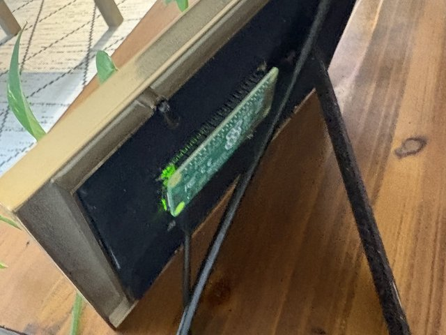

# events-display

 

Shows upcoming calendar events on a Pimoroni Inky Impression 7.3" (Spectra 6, 800x480) attached to a Raspberry Pi. Without display hardware it saves `events_preview.png` instead.

## Hardware
- Raspberry Pi Zero 2 W with a GPIO header (or the Zero 2 WH, which comes with one)
- Pimoroni Inky Impression 7.3" e-ink display (Spectra 6, 800x480)
- microSD card with Raspberry Pi OS
- Micro USB power supply (5V, 2.5A)
- 5x7 inch picture frame

## Setup (on the Pi)
```bash
pip install -r requirements.txt
cp .env.example .env   # add your secret iCal URLs, calendar names and DISPLAY_TZ
python3 events_display.py --once
```

For Korean, Chinese or Japanese titles and for emoji, install these fonts:
```bash
sudo apt install -y fonts-noto-cjk fonts-noto-color-emoji
```

### Add your calendars
For each calendar, find its private iCal (`.ics`) address in your calendar app's settings. Don't use a public address or an embed link.

Add it to `.env`, numbering each calendar and adding a label to show on the display:
```
DISPLAY_TZ=America/Los_Angeles
GCAL_ICAL_URL_1=https://example.com/private-.../calendar.ics
GCAL_NAME_1=Me
GCAL_ICAL_URL_2=https://example.com/private-.../calendar.ics
GCAL_NAME_2=Partner
```
Calendars 1, 2 and 3 are shown in blue, red and green; further calendars repeat those colors. Treat each secret address like a password: anyone who has it can read that calendar. Never commit `.env`.

Run it from cron; it only refreshes the display when what's on screen changes:
```
* * * * * flock -n /tmp/events_display.lock /path/to/python3 /path/to/events_display.py --once >> /path/to/events_display.log 2>&1
```
If a calendar can't be fetched for over an hour, the display shows the calendars that still work and a red "Not updated since" warning.

See `AGENTS.md` for architecture details. Built on [Pimoroni's inky library](https://github.com/pimoroni/inky) (MIT).
